# Xtream IPTV

A fast, TV-first **Xtream Codes** client for **Samsung Tizen TVs**. Browse your provider's
movies, series and live channels with the remote control, pick up where you left off, and watch
trailers, cast and guides, all in a clean, modern interface designed for a 1920x1080 screen.

<p align="center">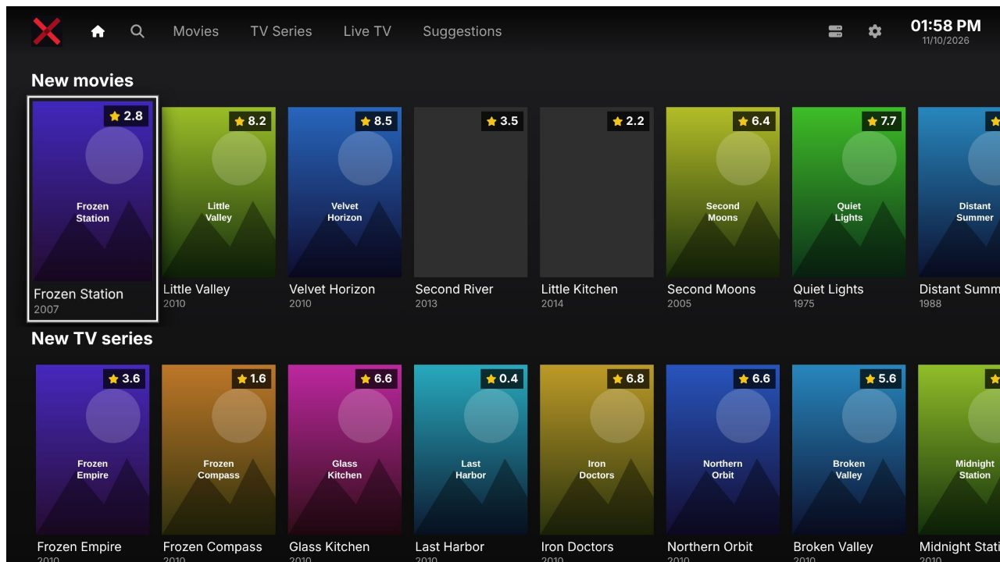</p>

> This project does not provide, host or link to any content. You need your own Xtream Codes
> provider account.

## What makes it different

- **One title, one card.** Provider catalogs are full of duplicates (4K, HD, dubbed, different
  categories). Items that share the provider's TMDB id are merged into a single card, with a
  dropdown to choose the exact version. Nothing is merged unless the provider says it is the same title.
- **Built for huge catalogs.** Tens of thousands of titles are synced in a background worker,
  stored locally and shown through virtualized grids, so navigation stays smooth on a TV processor.
  The cached catalog opens instantly and refreshes itself in the background.
- **Clean titles.** With a TMDB key configured, provider noise such as language prefixes, quality
  tags and year suffixes is removed from movie and series titles. Without a key, titles are shown exactly as the provider sent them.
- **Smart filtering.** Genres from the provider and from TMDB are merged into one list, categories
  can be hidden per provider and per type, and every detail page links back to the matching genre or category.
- **Trailers in the app's own player.** The trailer button plays the YouTube trailer with the same
  controls as a movie, instead of launching the YouTube app. It works around the embedded-player
  restriction of Tizen with a small on-TV service.
- **A real player.** Back / forward 30 s, draggable progress bar, aspect ratio, subtitles, adjustable
  buffering, resume from where you stopped and autoplay of the next episode.
- **Live TV with a programme guide.** Now-playing on every channel card and the next 24 hours on the channel page.
- **Trakt sync with a QR code.** Connect your account by scanning a code with your phone, import your
  history and keep watched titles in sync, or remove everything with one button.
- **Continue watching, favorites and suggestions.** Resume rows, a favorites page, watched marks and
  recommendations based on what you watch (TMDB or Trakt).
- **Parental control.** A PIN set on the first start hides the posters of adult categories and asks for
  the PIN before opening them; change it in Settings > Preferences.
- **Pinned categories and genres.** Pin the ones you use most to the sidebar, or add them to the favorites.
- **Notices.** Errors, warnings and confirmations (finished updates, subscription ending soon) appear in
  one place at the right of the screen, and never cover the video except for playback errors.
- **Local search.** Search movies, series and channels from the top bar, using the on-screen keyboard of the TV.
- **Several providers.** Add as many as you like and switch at any time; each has its own database.
- **Private by design.** No account, no analytics. TMDB and Trakt keys are typed in Settings and
  stay on the TV; credentials are masked in logs.
- **English and Italian**, following the TV language or chosen manually.
- **Open and tested.** Plain HTML, JavaScript and SCSS (no UI framework) with an extensive unit test suite.

## Screenshots

| | |
|---|---|
| 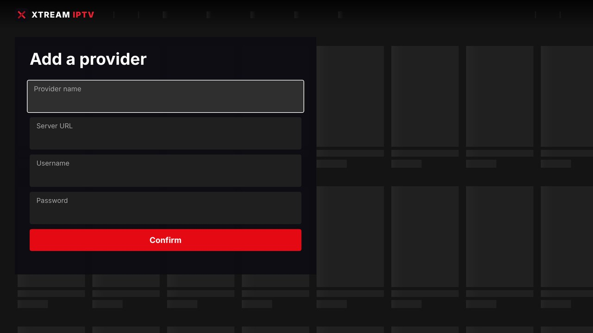 **First run**: add your provider |  **Home**: new movies, new series, continue watching |
| 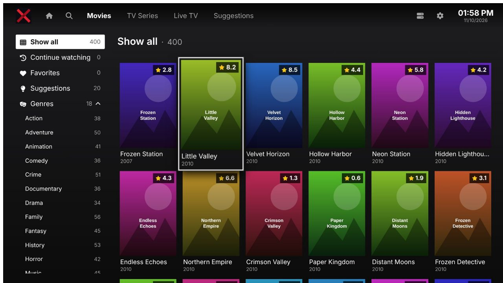 **Movies**: genres, categories and filters | 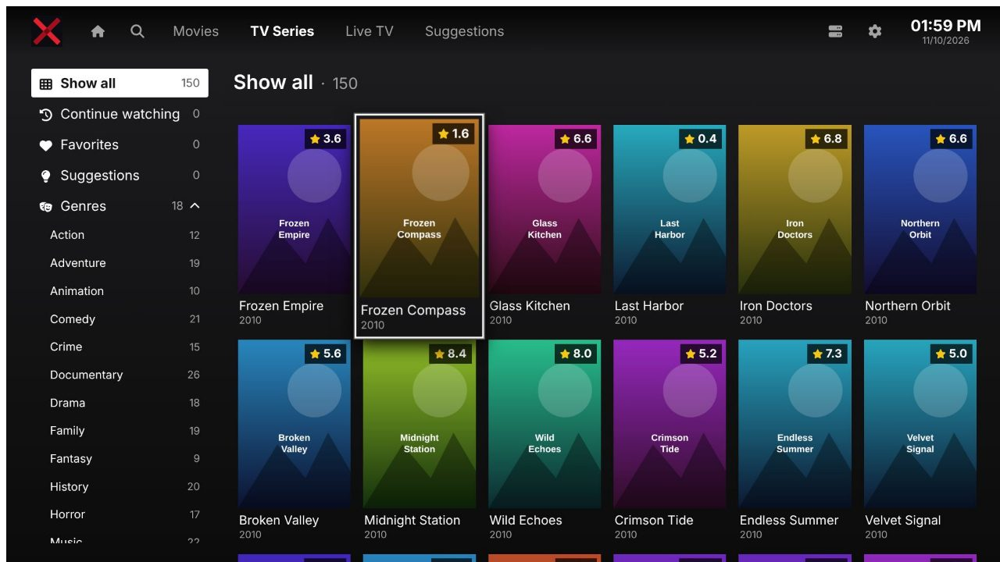 **TV series** |
| 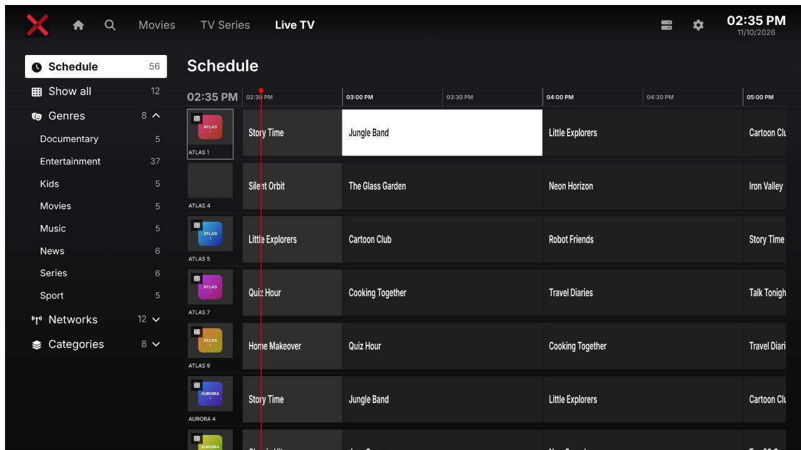 **Live TV** with the programme now playing | 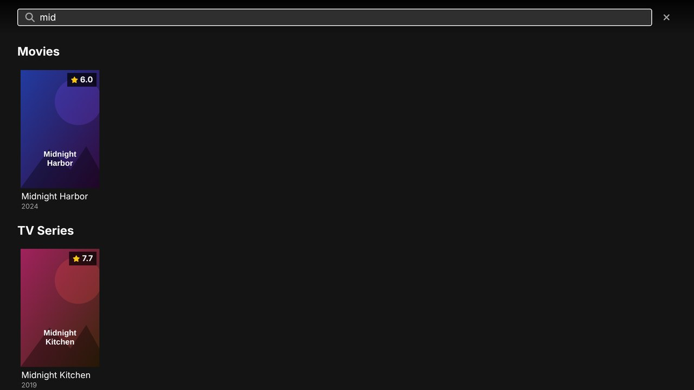 **Search** from the top bar |
| 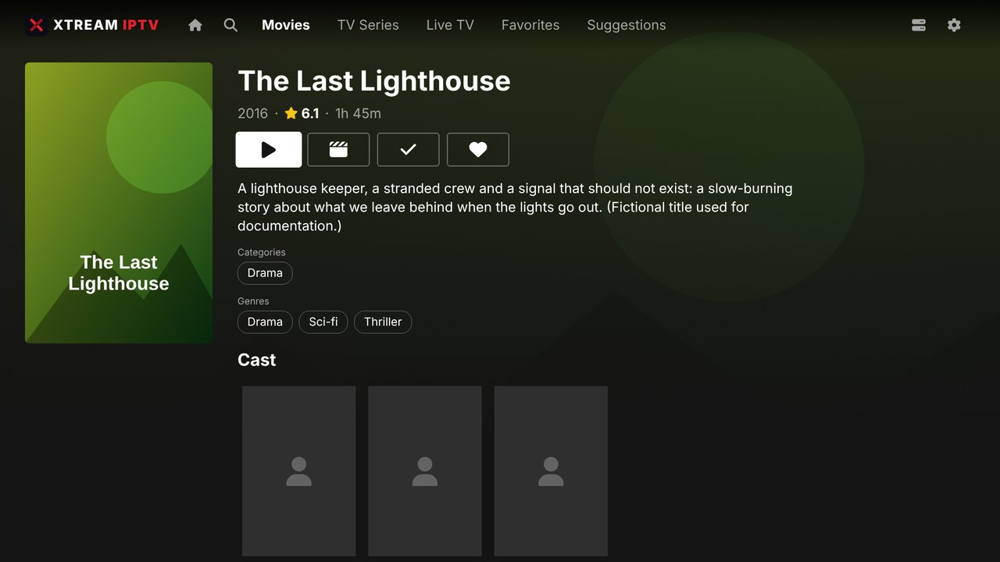 **Movie**: play, trailer, watched, favorite | 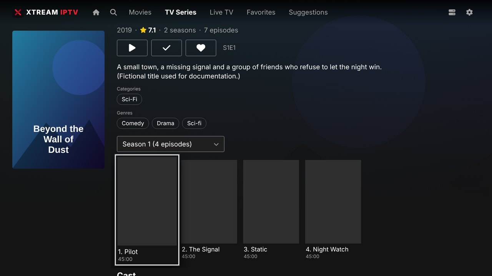 **Series**: seasons and episodes |
| 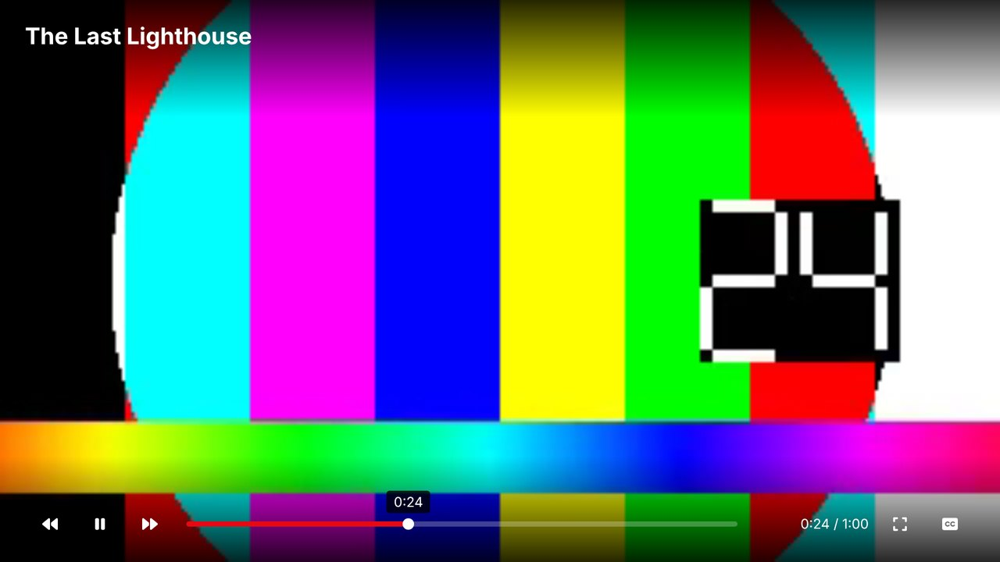 **Player** | 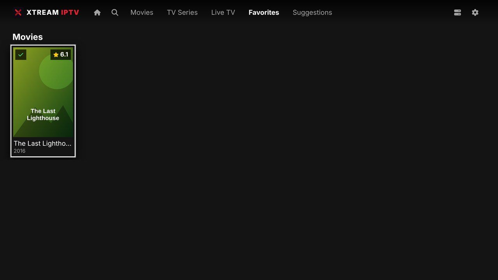 **Favorites** |
| 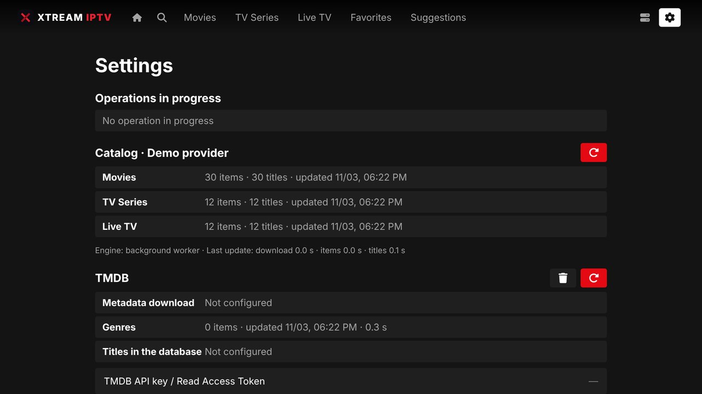 **Settings**: catalog, TMDB, Trakt, preferences | 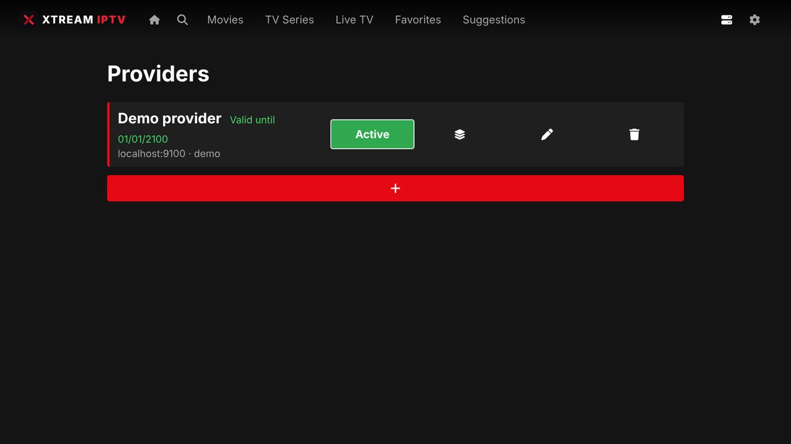 **Providers** |
| 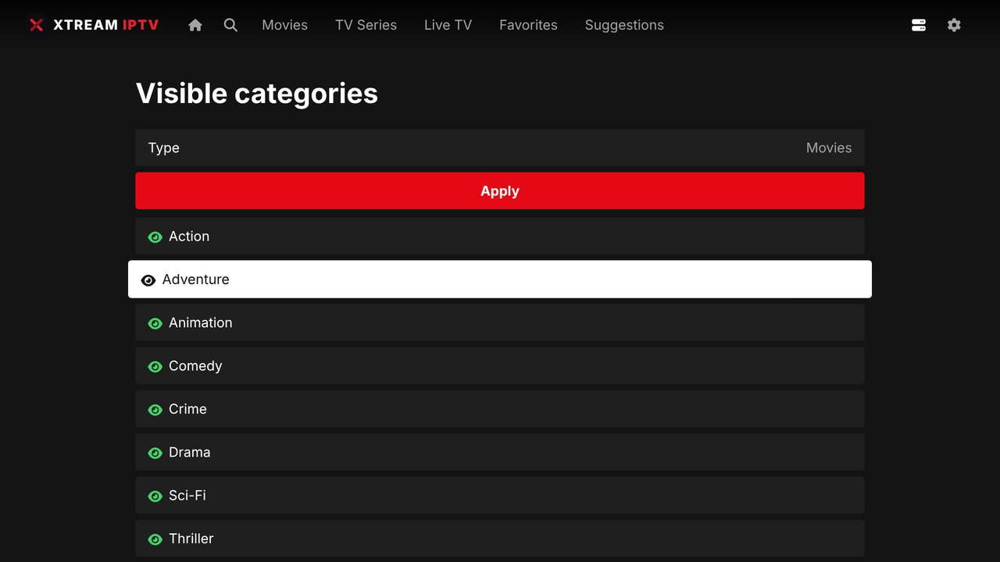 **Visible categories** | |

The screenshots use a fictional demo provider.

## Install on your TV

Requirements: a Samsung TV with **Tizen 6.0 or newer** (developed on a 2021 QLED) and an Xtream Codes provider account.

1. Download the signed `xtream-iptv-<version>.wgt` from the [Releases](../../releases) page.
2. Enable **Developer Mode** on the TV: open *Apps*, press `12345` on the remote, set Developer mode
   to **On**, enter the IP address of the computer you will install from, and reboot the TV.
3. Install the package with [**tizen-wgt-installer**](https://github.com/andreadegiovine/tizen-wgt-installer),
   a one-command tool (it needs Docker on a computer in the same network as the TV). It can re-sign
   the package with your own Samsung certificate, which recent TVs require; see its page for the exact
   commands for Linux, macOS, WSL and Windows.
4. Open **Xtream IPTV** from *Apps → Downloaded* and add your provider.

Prefer to build it yourself? See [Building from source](#building-from-source).

## First steps

1. **Add a provider**: name, server URL, username and password. The catalog downloads in the background.
2. *(Optional)* In **Settings** type a **TMDB** key to get posters, plots, cast, genres, trailers and suggestions.
   Use the v4 "API Read Access Token" or the 32-character v3 key.
3. *(Optional)* In **Settings** type your Trakt **Client ID** and **Client Secret**, then press connect and scan the QR code.

Nothing about TMDB or Trakt is compiled into the app: both stay off until you add the keys.

## Remote control

| Key | Action |
|---|---|
| Arrows | Move the focus |
| OK / Enter | Select |
| Back | Go back / close |
| Channel up / down | In the player: previous / next channel (live) or episode (series) |
| Play / pause / rewind / forward | In the player |
| Left / right in the player | Seek (after OK on the progress bar) |

## Building from source

Requirements: Node.js 18 or newer, and for installing, [Tizen Studio](https://developer.tizen.org/development/tizen-studio/download)
(or its CLI) with a Samsung certificate profile.

```bash
npm ci
npm test            # unit tests
npm run lint
npm run dev         # desktop browser on http://localhost:8080
npm run build       # Tizen widget in dist/
```

In the desktop browser the remote is emulated with the keyboard: arrows, `Enter`, `Esc` / `Backspace`
for Back, `PageUp` / `PageDown` for channel up / down. The dev server proxies provider calls
(`/__proxy`) to avoid CORS problems.

`dist/` is a complete widget. Sign and install it with your own certificate:

```bash
tizen package -t wgt -s <your-profile> -- dist
sdb connect <tv-ip>
tizen install -n dist/XtreamIPTV.wgt -t <tv-name>
```

### Releases

Publishing a GitHub release runs `.github/workflows/release.yml`: it validates the tag (`v1.2.3`) and runs lint and tests,
then one job per platform stamps the version, builds and uploads its package, named `xtream-iptv-<version>_<platform>`
(today the signed Tizen `xtream-iptv-<version>_tizen.wgt` with its checksum, made by `platforms/tizen/package.sh`).

## For developers

```
src/
  core/       env, errors, logger (masks credentials), http, idb, input
  db/         app database and one database per provider
  services/   Xtream client, sync, grouping, title normalisation, TMDB, Trakt, EPG, player engines
  ui/         focus manager, router, top bar, pages, components
  i18n/       en-US and it-IT dictionaries
  styles/     SCSS
  platform/   the contract of a platform adapter (contract.js) and the adapter of the build (index.js)
platforms/
  tizen/      adapter (AVPlay, remote keys, system info, YouTube trailers), config.xml, YouTube service,
              signing certificate, build.js (files webpack copies) and package.sh (signed .wgt)
  webos/      adapter (<video>, Back 461, YouTube app via Luna), appinfo.json, build.js and package.sh (.ipk)
  desktop/    adapter (<video> + hls.js / mpegts.js, keyboard), Electron main process, electron-builder.json and
              package.sh (Windows .exe, macOS .dmg, Linux .AppImage / .deb)
logo.svg      the app logo: top bar, start screen, screensaver, and every platform icon (drawn at build time)
test/         Jest tests
docs/         design decisions, milestones and screenshots
```

Design decisions and the development history (with what has and has not been verified on a real
TV) live in [`docs/DESIGN.md`](docs/DESIGN.md) and [`docs/MILESTONES.md`](docs/MILESTONES.md); read them before changing the code.

The TV runs Chromium ~76: the build targets it and ESLint blocks newer APIs (`?.`, `??`,
`String.replaceAll`, `.at()`, `structuredClone`). CSS must avoid flexbox `gap`, `aspect-ratio` and `inset`.

Package id `XtrmIptv01`, application id `XtrmIptv01.XtreamIPTV` (`platforms/tizen/config.xml`).

The app logic is the same on every platform: what a platform changes (video engine, remote keys, exit, system information, trailers)
goes through the adapter in `platforms/<name>/platform.js`, picked at build time (`npm run build:tizen` / `build:webos` / `build:desktop`, i.e.
`webpack --env platform=<name>`; `npm run build` and `npm run dev` use Tizen, `npm run dev:webos` the webOS adapter, `npm run desktop` opens the desktop app in Electron). See [`docs/MULTIPLATFORM.md`](docs/MULTIPLATFORM.md).

## License

No license has been chosen yet.
